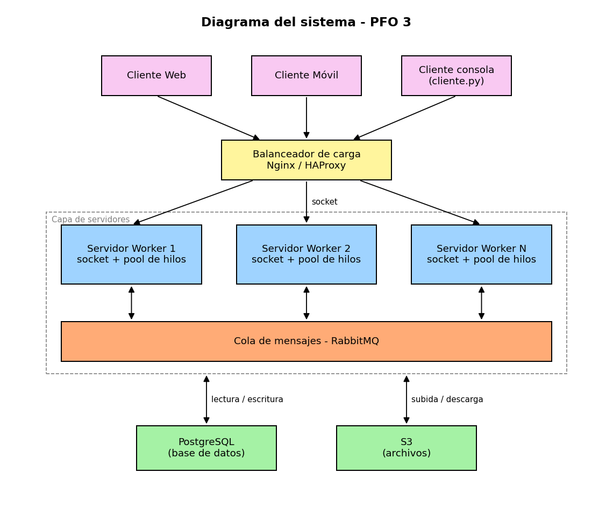

# PFO 3 - Sistema Distribuido Cliente-Servidor

Rediseño del sistema del PFO 2 como sistema distribuido usando sockets.
El servidor recibe tareas de los clientes y las reparte entre workers (pool de hilos).

## Archivos

- `servidor.py`: servidor con sockets que recibe tareas y las manda a un pool de 4 workers
- `cliente.py`: cliente de consola que envía tareas y muestra el resultado
- `requirements.txt`: librerías necesarias

## Diagrama del sistema

- **Clientes**: web, móvil y el cliente de consola.
- **Balanceador de carga (Nginx/HAProxy)**: reparte las conexiones entre los servidores.
- **Servidores workers**: reciben las tareas por socket y las procesan con un pool de hilos.
- **RabbitMQ**: cola de mensajes para comunicar los servidores entre sí.
- **PostgreSQL y S3**: PostgreSQL guarda los datos y S3 los archivos.

En este trabajo se programó el cliente y un servidor worker. En lugar de PostgreSQL se usa SQLite.

## Cómo ejecutarlo

1. Instalar las librerías:  
      pip install -r requirements.txt
2. Ejecutar el servidor:  
      python servidor.py
   Queda escuchando en `127.0.0.1:5000`.
3. En otra terminal ejecutar el cliente:  
      python cliente.py

## Tareas

El cliente manda un JSON con la tarea y los datos, por ejemplo:
`{"tarea": "sumar", "datos": {"numeros": [1, 2, 3]}}`

- `registro`: registra un usuario (contraseña hasheada)
- `login`: verifica usuario y contraseña
- `sumar`: suma una lista de números
- `contar_palabras`: cuenta las palabras de un texto
- `mayusculas`: pasa un texto a mayúsculas
- `tarea_lenta`: espera 3 segundos (sirve para probar varios clientes a la vez)
